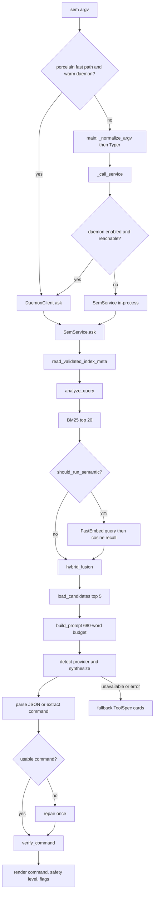

# Architecture Overview

`sem` (package `sempropos`) is an offline-first command assistant built around one canonical, content-hashed `ToolSpec` per installed executable. It exposes three user-facing modes — **ask** (natural-language command synthesis), **show** (structured reference card), and **search** (ranked tool discovery) — plus lifecycle commands for indexing, models, configuration, diagnostics, and the warm daemon.

The design separates the user interface from the query engine:

- `sempropos.cli` is a thin Typer/Rich layer that normalizes argv, dispatches RPC calls, and renders results.
- `sempropos.service.SemService` owns index validation, retrieval, synthesis, verification, and diagnostics. The same class runs in-process for one-shot commands or inside the warm daemon for repeated queries.
- `sempropos.daemon` is a stdlib-only Unix-socket JSON-RPC transport around `SemService`; it keeps SQLite connections, embeddings, and local models warm between invocations.

## Module map

| Package | Responsibility | Key modules |
| --- | --- | --- |
| `sempropos` root | CLI commands and rendering, config, shell snippets, shared utilities | `cli.py`, `service.py`, `config.py`, `shell.py`, `utils.py`, `main.py` |
| `sempropos.daemon` | Warm daemon server, stdlib-only client, framed JSON-RPC protocol | `server.py`, `client.py`, `protocol.py`, `__main__.py` |
| `sempropos.model` | Canonical `ToolSpec`, `FlagSpec`, `SubcommandSpec`, `ExampleSpec`, `CandidateContext` | `spec.py` |
| `sempropos.sources` | PATH discovery, man/roff parsing, tldr ingest, completion parsing, safe `--help` probing, multi-source merge | `discovery.py`, `man.py`, `roff_parser.py`, `tldr.py`, `completions.py`, `help_probe.py`, `merger.py` |
| `sempropos.index` | Index build orchestration, SQLite v3 schema, repository queries, staleness checks | `builder.py`, `schema.py`, `repository.py`, `staleness.py` |
| `sempropos.retrieval` | Query analysis/expansion, weighted BM25, cosine recall, hybrid fusion, per-tool flag/subcommand/example selection | `query.py`, `expansion.py`, `bm25.py`, `semantic.py`, `fusion.py`, `flag_retrieval.py` |
| `sempropos.intelligence` | Provider contracts and dispatch, prompt budgeting, JSON parsing, grounding/safety verification, provider adapters | `contracts.py`, `facade.py`, `models.py`, `prompt.py`, `safety.py`, `providers/*` |

## Request flow

The diagram shows the ask path; `search` and `show` enter `SemService` directly and skip synthesis.

### 1. CLI dispatch and service boundary

`sempropos.cli:main` first calls `_try_porcelain_fast_path`. When `--porcelain` is present, no daemon bypass flag is set, and a warm daemon is already listening, the CLI imports only `sempropos.daemon.client` and returns the command without loading Typer, Rich, NumPy, or FastEmbed. Otherwise `_normalize_argv` rewrites bare natural-language input into the `ask` subcommand and Typer dispatches normally.

Every command calls `_call_service`, which reads `config.load_config().daemon`. If the daemon is enabled and reachable (or can be auto-started), the request is sent over the Unix socket. If the daemon is disabled, unavailable, or explicitly bypassed with `--no-daemon`, the CLI constructs an in-process `SemService`, calls the same method, and closes it.

`SemService` caches a read-only SQLite connection and reloads it when `index.meta` changes. `reload()` closes the connection, drops the memory-mapped embedding matrix, and lets the next request reopen both. This is how `sem update` and `sem install` make a running daemon pick up a fresh index.

### 2. Retrieval

Retrieval is BM25-primary with semantic recall as a secondary signal.

- `analyze_query` normalizes tokens, detects artifacts and intents, and produces weighted synonym expansions.
- `query_bm25_ranking` queries `tools_fts` with column weights `12.0, 10.0, 6.0, 4.0, 4.0, 3.0, 1.5` for name, aliases, summary, tags, subcommands, examples, and flags. Raw FTS magnitude is squashed with `m / (m + 8)`. Exact name and alias matches add `1.6` and `1.4`; synonym-only hits are scaled by `0.35`; a multi-token AND match adds `1.15` plus `0.35 ×` its FTS score. Artifact and intent boosts from the analyzer are added last.
- `should_run_semantic` decides whether to load the embedding model. It always runs when embeddings are already warm in daemon mode or `embedding.lazy_fallback` is disabled. On a cold one-shot query, a high-confidence lexical result (top score ≥ `1.65` and margin ≥ `0.45`) skips the ONNX model entirely; artifact-boosted results can skip at a lower score.
- `query_semantic_matches` embeds the query with `kind="query"` and computes cosine similarity against the memory-mapped float32 matrix.
- `hybrid_fusion` sorts lexical hits by descending BM25 score, uses semantic rank only to break exact ties, assigns reciprocal-rank scores `1 / (60 + rank)`, then appends semantic-only hits with score `0.0` below every lexical hit.

`search` differs from `ask`: it runs semantic recall only when the embedding model is already warm or BM25 returned no results, keeping `sem search` effectively LLM-free and instant.

### 3. Candidate assembly

`load_candidates` attaches the stored summary, description, category, aliases, synopsis, and query-relevant subcommands, flags, and examples. For `ask`, the budget is up to 5 tools with 4 subcommands, 8 flags, and 4 examples each; a `--tool` filter raises those limits to 12 flags and 6 examples for one tool. `search` uses a smaller display budget (3 subcommands, 3 flags, 2 examples).

### 4. Prompting and synthesis

`build_prompt` emits a `StructuredPrompt` with the fixed system instruction, truncated candidate context, query, and the JSON schema for `{tool, command, explanation, alternatives, none}`. The budget is `MAX_PROMPT_WORDS = 680`. When over budget it reduces examples from 4 to 1, then flags from 8 to 4, then subcommands from 4 to 2, then tools from 5 to 1.

`detect_synthesis_provider` returns the configured backend when it is available and raises `ProviderUnavailableError` otherwise. `synthesize` dispatches to `local_gguf`, `ollama`, `openai_compatible`, or the always-available deterministic `tier0` provider. `tier0` either matches a retrieved example whose token overlap is at least `0.55` or returns no command so the CLI renders reference cards.

`parse_synthesis_output` prefers a JSON object, accepts a plain command after sanitizing fences and shell prompts, rejects prose and usage/synopsis echoes, and records the explicit `none` sentinel. If no command is produced and the model did not explicitly answer `none`, `_repair_once` retries with an instruction to return one concrete command or `none=true`.

### 5. Verification and output

Before rendering, `verify_command` checks the primary executable against `$PATH`, resolves wrapper commands, cross-checks generated flags against the matched `ToolSpec`, and classifies the command as `safe`, `caution`, or `destructive`. The CLI prints a colored command panel, a safety notice, and optional `--explain` flag explanations.

The fallback ladder is:

| Situation | Behavior |
| --- | --- |
| Index missing or incompatible | `index_error` with the `sem update` instruction; exit 3 |
| No relevant tools | `no_candidates` message; exit 3 |
| Provider unavailable, unconfigured, or failing | `fallback` containing ranked candidates; CLI prints up to four ToolSpec cards |
| Tier-0 selected and no confident example | Card fallback; exit 0 because this is an expected offline mode |
| Model output unusable | One repair retry, then card fallback with exit 1 |
| `--porcelain` failure | Diagnostic on stderr, nothing on stdout, non-zero exit |

## Data layout

Runtime assets live under `platformdirs` user paths unless overridden:

- Config: `~/.config/sempropos/config.toml` (override `SEMPROPOS_CONFIG_DIR`; legacy `intelligence.toml` is still read when `config.toml` is absent).
- Data: `~/.local/share/sempropos/` (override `SEMPROPOS_DATA_DIR`) containing `index.db`, `tool_embeddings.npy`, `tool_embedding_ids.npy`, `index.meta`, `last_indexed`, plus `tldr/`, `models/`, `embeddings/`, and `bin/` caches.
- Runtime: `$XDG_RUNTIME_DIR/sempropos/` (override `SEMPROPOS_RUNTIME_DIR`) containing `sem.sock`, `sem.pid`, and `sem.lock`; without an XDG runtime directory the daemon falls back to `<data>/run/`.

Exact path rules and metadata validation are covered in [Configuration and Paths](configuration.md); the database is documented in [Index Database Schema](index-schema.md).

## Design principles visible in the code

- **Offline first.** The default synthesis provider is `tier0`, embeddings are cached under the application data directory, and indexing reads local man pages, tldr snapshots, and completions without network access.
- **Lexical authority.** `retrieval/fusion.py` treats BM25 as primary and uses semantic rank only for ties and recall, avoiding a symmetric score blend that would let weak vector matches outrank exact tool names.
- **Bounded prompt and bounded memory.** Prompt construction reduces context until it fits 680 words; indexing streams tools and writes embeddings batch-by-batch; retrieval memory-maps the embedding matrix.
- **Never invent tools.** The system instruction restricts synthesis to retrieved `ToolSpec` context and makes `none` the honest answer when nothing fits.
- **Ground before showing.** `verify_command` grounds executables and flags, and destructive patterns raise explicit warnings.
- **Command inserted, never executed.** Shell integration only rewrites the current command line; see [Shell Integration](shell-integration.md).

## Related pages

- [CLI Surface and Query Dispatch](cli.md)
- [Quickstart](quickstart.md)
- [Indexing Pipeline](indexing.md)
- [Retrieval and Ranking](retrieval.md)
- [Prompting and Synthesis Providers](synthesis.md)
- [Operations and Troubleshooting](operations.md)
