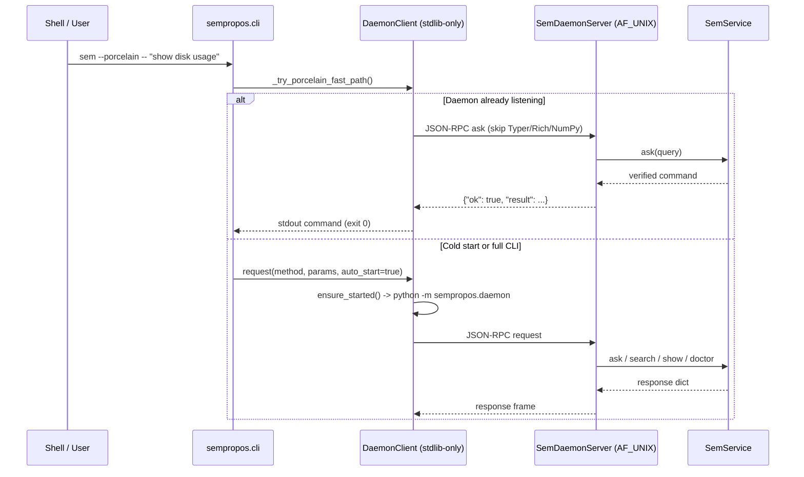

# Warm Daemon & Service Layer

`sem` eliminates repeated cold-start latency for SQLite index loading, FastEmbed ONNX inference, and local GGUF models by running an auto-managed, user-private Unix-domain socket daemon (`sempropos.daemon`) backed by the UI-agnostic `SemService` query engine (`sempropos.service`).

When the daemon is disabled (`daemon.enabled = false`), unreachable, or bypassed (`--no-daemon`), the CLI instantiates `SemService` in-process and executes the exact same code path.

## Request Lifecycle & Fast Path

## `SemService` Application Layer

`SemService` (`src/sempropos/service.py`) owns all read-only query execution and diagnostics without importing `typer` or `rich`:

- **Hot connection & automatic reload:** `_get_conn()` caches a read-only SQLite connection (`open_connection(read_only=True)`) and tracks the `index.meta` modification timestamp and database path. Whenever `sem install` or `sem update` replaces `index.meta`, `SemService` automatically closes the stale handle, calls `reload_embeddings()`, and reopens fresh state on the next request.
- **Tri-modal operations:**
  - `search(query, limit, category)` — Instant `apropos` replacement using `analyze_query` + weighted Porter BM25; invokes semantic recall only when embeddings are already warm in memory or BM25 returns zero hits.
  - `show(tool_name, subcommand, flag_filter)` — Instant `man`/`--help` card lookup via `repository.get_tool()`, with optional subcommand focus and case-insensitive flag filtering.
  - `ask(query, tool_filter, backend, alternatives)` — Full retrieval, `build_prompt` (680-word budget), provider synthesis, one `_repair_once` retry on non-empty unusable output, and `verify_command` grounding/safety classification.
  - `doctor()` — Reports index completeness, revision, parse coverage percentages, source breakdown, unindexed `$PATH` binaries, provider status, and local GGUF runtime readiness.
- **Clean teardown:** `close()` closes the SQLite connection, clears mmap vectors, and calls `shutdown_providers()` to unload ONNX/GGUF models and terminate any managed `llama-server` child process.

## `SemDaemonServer` & Lifecycle

`SemDaemonServer` (`src/sempropos/daemon/server.py`) binds a private Unix stream socket (`AF_UNIX`, `SOCK_STREAM`) at `$XDG_RUNTIME_DIR/sempropos/sem.sock` (falling back to `<data_dir>/run/sem.sock` when `XDG_RUNTIME_DIR` is absent or `SEMPROPOS_DATA_DIR` / `SEMPROPOS_RUNTIME_DIR` is set):

- **Single-instance locking & permissions:** Runtime directory permissions are tightened to `0700`, the socket file is `chmod 0600`, and `fcntl.flock(LOCK_EX | LOCK_NB)` on `sem.lock` guarantees at most one active daemon per runtime directory. Stale sockets from ungraceful exits are unlinked before binding.
- **Supported RPC methods:** `ping`, `status`, `reload`, `shutdown`, `list_names`, `doctor`, `search`, `show`, and `ask`.
- **Idle auto-shutdown:** The accept loop polls every `0.5s` and exits cleanly after `daemon.idle_timeout_seconds` (default `900s` / 15 minutes) of inactivity, releasing all held RAM/VRAM and unlinking `sem.sock` and `sem.pid`. `SIGINT` and `SIGTERM` trigger the same clean teardown.

## `DaemonClient` & `--porcelain` Fast Path

`DaemonClient` (`src/sempropos/daemon/client.py`) and `protocol.py` import **only Python standard-library modules** (`socket`, `json`, `os`, `subprocess`, `time`, `pathlib`) using newline-delimited JSON frames (`PROTOCOL_VERSION = 1`, `MAX_MESSAGE_BYTES = 2 MiB`):

- **`try_fast_porcelain_ask()`:** Invoked by `sempropos.cli:main` before importing Typer, Rich, NumPy, or FastEmbed. When `--porcelain` is passed (as in `Ctrl+S` shell widgets) and a warm daemon is already listening, the CLI sends the `ask` RPC directly and prints the command in milliseconds.
- **Lazy auto-start:** `DaemonClient.request(..., auto_start=True)` spawns detached `sys.executable -m sempropos.daemon --socket <path>` (`start_new_session=True`, `close_fds=True`) if the socket is absent and polls `ping` for up to `3.0s` before retrying the RPC.

## Configuration & Management

- `daemon.enabled` (default `true`): Enables daemon dispatch for CLI queries.
- `daemon.auto_start` (default `true`): Allows queries to spawn the daemon on demand.
- `daemon.idle_timeout_seconds` (default `900`, minimum `30`): Inactivity window before automatic shutdown.
- CLI controls: `sem daemon status [--json]`, `sem daemon start`, `sem daemon stop`, and `sem daemon restart`.

## Related pages

- [Architecture Overview](architecture.md)
- [CLI Surface and Query Dispatch](cli.md)
- [Configuration and Paths](configuration.md)
- [Operations and Troubleshooting](operations.md)
